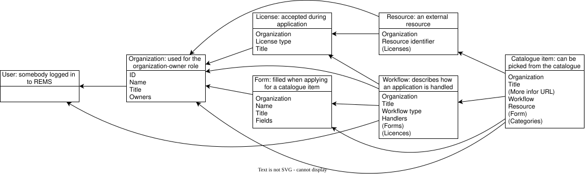
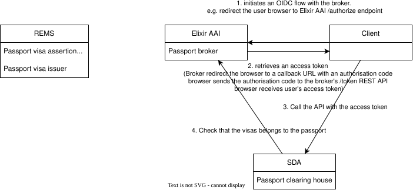

Introduction
---

This is a work in progress. This repository tries to deploy the SDA stack, all in one place.
We had a breaking change, instead of relying on the starter-kit repositories, we now depend on the original SDA repository.

Modifications applied by this repository
---
1. Add the dependencies to SDA and REMS with `git submodule add ...`. The submodules are included and configured in [docker-compose.yml](docker-compose.yml).
2. [SDA](https://github.com/neicnordic/sensitive-data-archive/)
   * Created a [.env](configuration/sensitive-data-archive/.env) that specifies the version of SDA to use
   * Created a [rems-client.yaml](configuration/aai-mock/clients/rems-client.yaml). The whole configuration folder is added to the submodule default configuration with the service `aai-mock-config-init` in [sensitive-data-archive.override.yml](sensitive-data-archive.override.yml).
3. [REMS](https://github.com/CSCfi/rems)
   * Move the initialization of the database in [rems.override.yml](rems.override.yml) in the service `rems-migrate`, instead of the imperative `docker-compose run --rm -e CMD="migrate" app`
   * Created a [config.edn](configuration/rems/config.edn) with `oidc` authentication instead of `fake`.
   * Add `extra_hosts: "localhost:host-gateway"`  for the service `app` so it can reach `lsaai-mock`. 

Diagram
---
[sda-s3-dependency-diagram.html](figs/sda-s3-dependency-diagram.html)

Using the stack
---
1. [Administering REMS](rems/docs/installing-upgrading.md)
   * Login into REMS at http://localhost:3000/ so the user is created in the REMS database. Users are specified in the [aai-mock configuration](sensitive-data-archive/.github/integration/sda/aai-mock/userinfos).
   * Give the owner role to the user. 
   ```
   docker exec sda-deployment-app-1 java -Drems.config=/rems/config/config.edn -jar rems.jar grant-role owner testu@lifescience-ri.eu
   ```
   * Restart REMS, and the user can now access the [administration UI](http://localhost:3000/administration/catalogue-items).

Where to find the documentation
---
* REMS
   * [rems/docs/glossary.md](rems/docs/glossary.md): explains REMS concepts and user roles 
   
   * [rems/docs/ga4gh-visas.md](rems/docs/ga4gh-visas.md): REMS can produce and consume GA4GH Visas that assert a User's access rights. REMS acts as a `passport visa assertion repository`, `passport visa issuer`, and `embedded token issuer`.
      * Passports: transport identity and access qualifications between organizations and computing environments. Passports contain the minimal personally identifiable information. Passports are not centralized, there can be multiple passport issuers and data controllers.
      * Visas: live inside a passport. Represents a collection of qualifictions and permissions, such as the entitlement to access a dataset for a specific amount of time or membership to a group for implicit authorisation. Visas are verifiable with a signature that can be checked before data access.
      * [WEBINAR - using the GA4GH toolkit: GA4GH Passports Part 2 (Technical Deep Dive)](https://www.youtube.com/watch?v=K7HID5KAhz0):
         * Relationship of System Actors
            1) `Passport visa assertion repository` (REMS): When the data access commitee (DAC) makes a decision, the assertion (the decision) has to be stored in a database.
            2) `Passport Visa Issuer` (REMS): Takes the assertion from the database, formats it into a visa, and signs it. 
            3) `Passport broker` (Elixir AAI): Logs users in and asks the visa issuer to issue visas related to the user. But doesn’t generate the visas.
            4) `Passport clearinghouse` (SDA): the service that checks the visa and enforces the access to data.
         * OIDC flows: the main protocol to ship the passports
         
         * There are five visas types: 
            * Affiliation And Role (e.g., the owner is part of an university)
            * Accepted terms and policies
            * Researcher Status (e.g., the owner is a researcher)
            * ControlledAcccessGrant (e.g., the owner has been granted access to a dataset)
            * Identity
         * Security concerns: 
            * it is possible to steal someone's passport and impersonate them. E.g., one attacker can create a rogue passport clearing house by hosting SDA, receive passports from users wanting access, and use these passport to access data on other clearing houses.
            * One solution to prevent these attacks is to bind passport access tokens to a specific clearing house. I.e., the entitlement is for a ressource at a location, and only this location.


   * [rems/docs/Event-notification.md](rems/docs/Event-notification.md): Not used by AIDA data hub in favor of the API.
   * [rems/docs/bots.md](rems/docs/bots.md): Not used by AIDA data hub in favor of the API.
   * [rems/docs/plugins.md](rems/docs/plugins.md): Not used by AIDA data hub in favor of the API.
   * [rems/docs/using-the-api.md](rems/docs/using-the-api.md)
      * Documentation at http://localhost:3000/swagger-ui.
      * The API can be used to populate REMS through code. This can be used, instead of doing the work manually on the administrative section of the website, by writing a script in Python. A script is better as it prevents manual mistakes, reduces the number of owner accounts, enables versioning of the state in a git repository, and increases portability as the script can also be used to connect to other services (e.g. for compute allocation).
      * However, one has to maintain a state for the script, e.g., to know if the automation has already been performed or not. It is possible to use the "notes" associated with each entity (e.g., entitlement, ressource, or organization) to flag if the script should perform any action or not.
      * However, one has to be notified to know when REMS data has changed and an action should be performed. This can be done by running a script in a loop, e.g. every five minutes.
   


Troubleshooting wiki
---
* Compiling the SDA image
  * Should we run the build-all command?
  * Or should we replace the image parameter from PR${PR_NUMBER} to ${PR_NUMBER} so we can use "v4.0.2" ?

